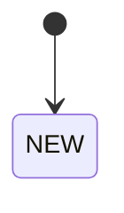

# Тест-дизайн (ЛР2)

Вариант: <!-- номер -->

Оставьте заголовки разделов как есть: автопроверка находит разделы по ним.

## Классы эквивалентности

<!-- Таблица: параметр | допустимые классы | недопустимые классы | представитель класса.
     Минимум 5 строк: количество, число позиций, промокод, уровень карты, способ доставки… -->

## Граничные значения

<!-- Для каждой границы своего варианта: значение на границе и по обе стороны от неё.
     MAX_QTY, MAX_ITEMS, BULK_QTY, PROMO_MIN, FREE_DELIVERY_FROM, MAX_DISCOUNT. -->

## Таблица решений

<!-- Условия: карта лояльности, оптовая скидка, промокод. Действие: итоговый % скидки
     с учётом потолка MAX_DISCOUNT. Минимум 6 правил (столбцов или строк) с числами вашего
     варианта. -->

## Диаграмма состояний

<!-- Диаграмма Mermaid (GitHub рисует её сам) со всеми статусами заказа и переходами,
     а под ней — таблица переходов, включая запрещённые.

-->
